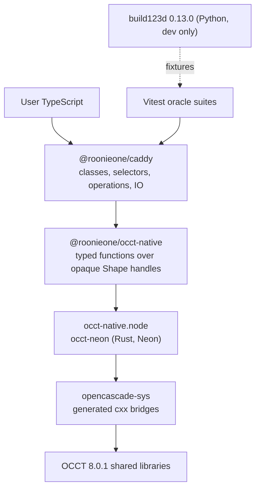

# Architecture

Caddy is a CAD modeling library for Node.js. A model is ordinary TypeScript that creates and combines exact BREP shapes; every geometric operation runs in Open CASCADE Technology (OCCT) 8.0.1 through a native Node-API addon. Behaviour follows Python build123d 0.13.0, which runs the same OCCT version and serves as the test oracle.

## Layers

| Layer | Responsibility | Does not |
| --- | --- | --- |
| `@roonieone/caddy` | build123d's algebraic API in TypeScript: geometry values (Vector, Axis, Plane, Location), the shape class hierarchy, ShapeList selectors, part/sketch/curve objects, operations, import/export | call OCCT directly, hold native objects other than shapes |
| `@roonieone/occt-native` | a reasonably low-level, Caddy-independent JS API: create/transform/combine/inspect/serialize shapes; typed wrappers and coded errors | know about build123d semantics (alignment, selectors, class casting) |
| `occt-neon` | compose OCCT calls into one JS function per operation; convert errors; own JS-visible shape lifetimes | expose OCCT classes to JavaScript |
| `opencascade-sys` | 1:1 cxx bindings to allowlisted OCCT classes, generated | contain hand-written modeling logic |

Geometry values (points, frames, matrices) are plain numbers on the JS side and cross the boundary as `Float64Array`s. Only shapes stay native, so a modeling script never serializes BREP data between operations.

## Design decisions

- **Algebraic API only.** build123d's builder contexts (`BuildPart`, `BuildSketch`, `BuildLine`, implicit modes) are not ported. Python operators become named methods (`union`, `subtract`, `intersect`, `transform`, `positionAt`, …). Shapes are immutable; operations return new shapes.
- **One kernel version.** OCCT is pinned to 8.0.1, the version build123d 0.13.0's OCP wheels use, so differential tests compare like with like.
- **Generated bindings.** See `docs/native-bindings.md`: every OCCT call returns `Result`, so kernel exceptions become JavaScript errors rather than process aborts.
- **Dynamic OCCT.** OCCT ships as replaceable shared libraries beside the addon (LGPL-2.1 §6(b)); see `docs/licensing.md`.
- **Synchronous by default.** Modeling calls are synchronous for a natural imperative API; file import/export is asynchronous.

## Rejected alternatives

| Alternative | Why not |
| --- | --- |
| WebAssembly OCCT (opencascade.js, replicad) | Not native; Emscripten heap lifetimes; brief requires Node-API |
| Python build123d subprocess | Brief forbids a Python runtime dependency |
| `node-occ` | NAN, OCCT 7.2, unmaintained (see `docs/native-bindings.md`) |
| opencascade-rs `opencascade-sys` as-is | non-`Result` bridges abort the process on OCCT exceptions; OCCT 7.8 only; coverage gaps |
| opencascade-rs high-level `opencascade` crate | panics on user input; opinionated types |
| Hand-written C++ shim per Caddy operation | owner chose generated bindings that stay close to opencascade-rs |
| Static OCCT inside the addon | LGPL §6(a) relink obligations per platform |
| Builder/context API, reactive graph, DSL | brief: imperative TypeScript is the modeling language |

## Testing

`reference/build123d` runs the pinned build123d to generate JSON fixtures (shape metrics, geometry values, BREP files); Vitest suites assert Caddy against them with documented tolerances (`docs/test-oracle.md`). Native behaviour is also tested directly in `packages/occt-native/tests`.
